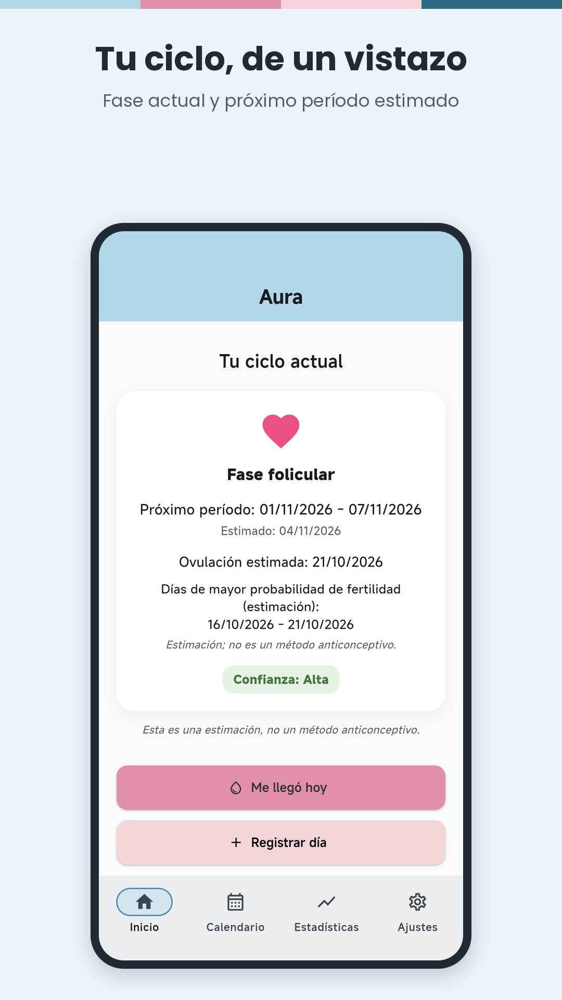
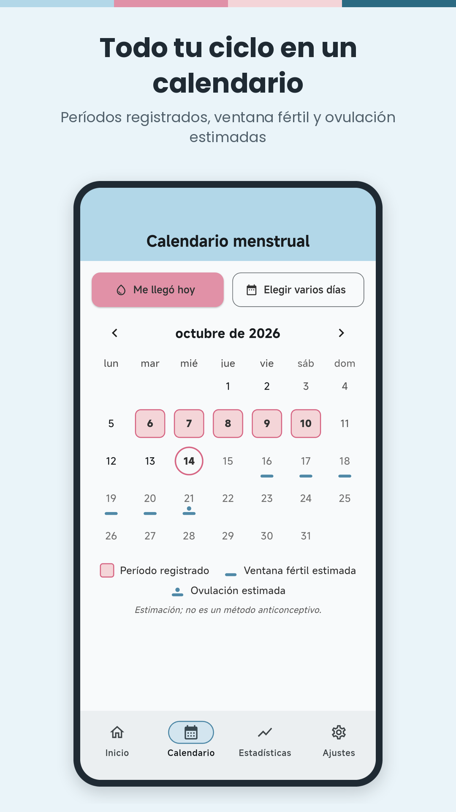
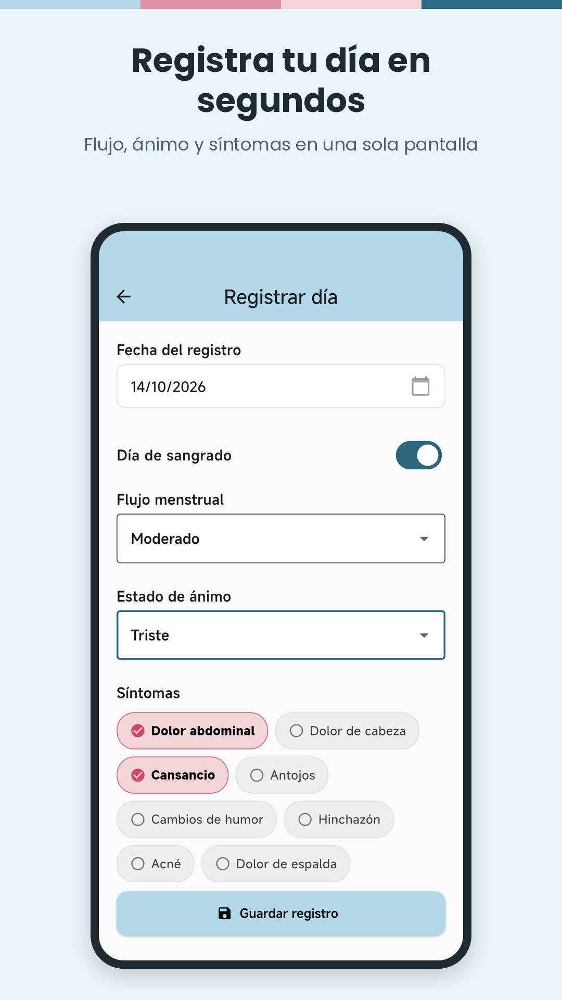
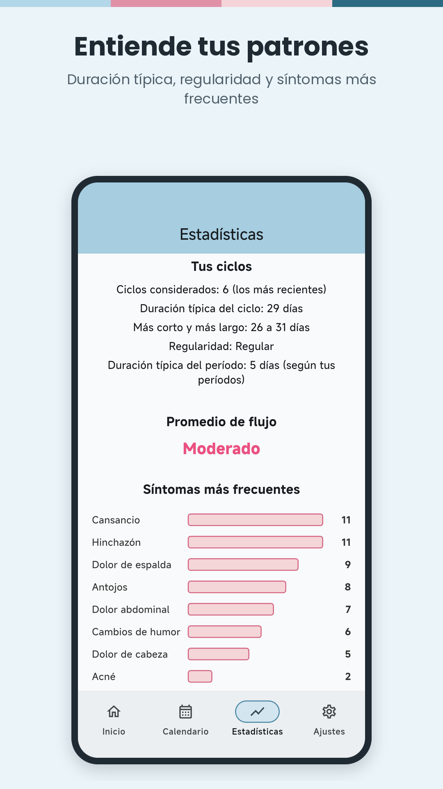
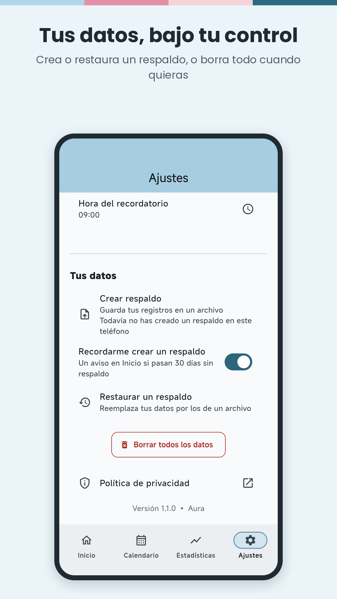
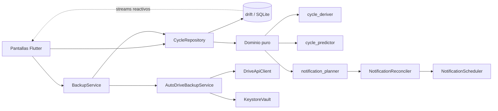

# Aura

Aplicación Android para registrar el ciclo menstrual y estimar sus fases. **Local primero**: sin cuenta, sin servidor propio y sin analítica. Los datos viven en el teléfono y solo salen en un respaldo que decide la usuaria: un archivo o, si lo activa, su propio Google Drive.

[English version](README.en.md)

**Sitio web:** [soofiaa.github.io/Aura](https://soofiaa.github.io/Aura/) · [Guía de uso](https://soofiaa.github.io/Aura/guia.html) · [Informe del proyecto](https://soofiaa.github.io/Aura/informe.html)

> **Estado:** v1.2.0, en prueba cerrada en Google Play · solo Android · proyecto personal de portafolio, en uso real.

## Capturas

<table><tr><td align="center"></td><td align="center"></td><td align="center"></td><td align="center"></td><td align="center"></td></tr></table>

Orden: Inicio, Calendario, Registrar día, Estadísticas y Ajustes. *Las capturas de Ajustes corresponden a la 1.1.0, antes del respaldo en Drive.*

## Qué hace

- Registra días de sangrado, intensidad del flujo, ánimo, síntomas y notas.
- "Me llegó hoy" en Inicio y en el Calendario: registra solo el primer día del período (hoy, ayer u otro día).
- Deriva los ciclos a partir de esos registros (no se "crean" ciclos a mano).
- Predice el próximo período con un **rango** y un nivel de confianza (baja / media / alta). La ovulación y la ventana fértil estimadas solo se muestran con confianza media o alta y sin período atrasado (en Inicio, tampoco durante la fase menstrual), y se pueden ocultar desde Ajustes.
- Muestra la fase actual: menstrual, folicular, ovulatoria y lútea (ninguna con el período atrasado).
- Calendario con los días registrados, los días estimados del período en curso (borde punteado), la ventana fértil y la ovulación estimadas (con las condiciones de confianza, atraso e interruptor de Inicio) y selección de varios días; pasa de día solo a medianoche y tiene "Ir a hoy".
- Estadísticas con "Tus ciclos": duración típica del ciclo, el más corto y el más largo, regularidad y duración típica del período.
- Recordatorios locales (opcionales) con texto discreto por defecto, y un aviso opcional "¿Te llegó el período?" el primer día de atraso.
- Permite marcar el fin del período y quitar marcas.
- Respaldo y restauración en un archivo JSON desde Ajustes → "Tus datos", con contraseña opcional para cifrar el archivo, "Deshacer" tras importar y "Deshacer la última importación" mientras exista la copia previa.
- Recordatorio de respaldo: si pasan 30 días sin crear uno, Inicio muestra una tarjeta (sin notificación); solo guarda en el teléfono la fecha del último respaldo y no envía nada fuera de él.
- **Respaldo automático en Google Drive** (opcional, apagado por defecto) en Ajustes → "Tus datos": una vez al día —al abrir la app, al reanudarla o al guardar un registro— sube a una carpeta **Aura** de la propia cuenta de Google el mismo respaldo cifrado. La contraseña se elige una sola vez y no sale del teléfono: la clave queda sellada en el Keystore de Android y sin esa contraseña el archivo no se puede leer. Aura entra a Drive con permiso `drive.file`, con el que solo ve los archivos que ella misma crea; se desconecta desde Ajustes y "Borrar todos los datos" olvida la cuenta. La compilación necesita un client ID de OAuth: ver [`docs/DRIVE_SETUP.md`](docs/DRIVE_SETUP.md).
- Borrado total de datos desde Ajustes (y compactación del archivo para no dejar restos).

## Privacidad por diseño

- Los datos viven en una base SQLite dentro del almacenamiento privado de la app.
- `allowBackup="false"`: Android no los copia a la nube, y `dataExtractionRules` tampoco los copia al cambiar de teléfono por cable o Wi-Fi: la única salida es un respaldo propio de la app.
- **"Ocultar Aura en Recientes"** (activo por defecto, se apaga desde Ajustes → Privacidad): la vista previa de la app en Recientes sale en blanco y no se pueden hacer capturas ni grabaciones de la pantalla.
- Al borrar todos los datos, la base se compacta (`VACUUM`) y las páginas sobrescriben lo borrado (`secure_delete`): no quedan restos de notas o síntomas ya eliminados.
- Los datos solo salen del teléfono si la usuaria crea un respaldo y elige dónde guardarlo o con quién compartirlo, o si activa el respaldo automático en su propio Google Drive (opcional, ver arriba). El archivo contiene datos de salud. Se puede proteger con una contraseña (opcional): se cifra en el teléfono (AES-256-GCM, con la clave derivada con Argon2id) y sin la contraseña no se puede leer (una contraseña débil se puede adivinar). En los respaldos en archivo, Aura no guarda la contraseña ni puede recuperarla; en el respaldo automático de Drive la guarda sellada con el Keystore de Android, para poder respaldar cada día sin pedirla. Sin contraseña, el archivo va sin cifrar y cualquiera que lo abra puede leerlo. La contraseña protege solo el archivo, no los datos dentro del teléfono. Aura no recibe ni guarda una copia. El permiso `INTERNET` existe solo para el respaldo automático en Drive; con él apagado, la app no usa la red.
- Al actualizar desde la 1.0 (esquema v3), antes de convertir la base la app guarda una copia de seguridad en su almacenamiento privado; se borra al guardar un respaldo en el teléfono, al abrir la app si tiene más de 30 días, o con "Borrar todos los datos".
- Al confirmar una importación, la app guarda antes una copia sin cifrar de los datos actuales en su almacenamiento privado, solo para "Deshacer"; la siguiente importación la reemplaza y "Borrar todos los datos" la elimina.
- Notificaciones con texto genérico y visibilidad privada en pantalla de bloqueo, salvo que el usuario active los detalles.
- Política de privacidad: [`docs/privacy.html`](docs/privacy.html).

## Documentación

- [Informe del proyecto](https://soofiaa.github.io/Aura/informe.html) (también en [PDF](docs/Aura_Informe.pdf)) y [guía de uso](https://soofiaa.github.io/Aura/guia.html)
- [Anexos técnicos](docs/anexos/00_INDICE.md): requisitos, casos de uso, arquitectura, modelo de datos, permisos y privacidad, calidad y pruebas, decisiones
- [Especificación funcional v1.1](docs/ESPECIFICACION_v1.1.md): historias de usuario, requisitos y criterios de aceptación.
- [HU-09: respaldo en Google Drive](docs/HU-09_respaldo_drive_v1.2.md)
- [Configuración de Drive](docs/DRIVE_SETUP.md)
- [Política de privacidad](https://soofiaa.github.io/Aura/privacy.html)

## Arquitectura



```
lib/
├── app_startup.dart
├── main.dart
├── domain/        # lógica pura, sin Flutter ni base de datos
│   ├── backup_codec.dart
│   ├── backup_crypto.dart
│   ├── backup_reminder.dart
│   ├── cycle_deriver.dart
│   ├── cycle_predictor.dart
│   ├── current_period.dart
│   ├── fertile_marks.dart
│   ├── legacy_period_ends.dart
│   ├── notification_planner.dart
│   ├── password_strength.dart
│   ├── range_selection.dart
│   └── symptom_ranking.dart
├── data/
│   ├── backup/          # BackupService, almacenes de archivo y recordatorio
│   │                    # + respaldo automático en Drive (HU-09): drive_api_client,
│   │                    #   auto_drive_backup_service, drive_backup_gateway, pre_migration_copy
│   ├── database/        # drift (esquema v5)
│   ├── models/          # enums de día (flujo, ánimo, síntomas)
│   ├── repositories/    # CycleRepository
│   ├── notifications/   # reconciler
│   └── device_settings_store.dart  # ajustes de este teléfono (sin migración)
├── screens/       # inicio, calendario, registro, estadísticas, ajustes, respaldo, onboarding
├── widgets/       # diálogos de contraseña, hojas de inicio de período, selector de síntomas, tarjeta de respaldo
└── utils/         # DayKey, colores, textos, zona horaria, Keystore, canales de Android
```

## Decisiones de diseño (y por qué)

**Fechas como texto `yyyy-MM-dd` y aritmética en UTC.** Un día del calendario no es un instante. Guardarlo como texto evita corrimientos por zona horaria. En Chile el cambio de hora ocurre a medianoche, así que a veces la medianoche local no existe; operar sobre `DayKey` en UTC elimina esa clase de errores.

**Ciclos derivados, no almacenados.** Solo se guardan los días de sangrado. Un nuevo ciclo empieza cuando el día de sangrado anterior está a más de 7 días. Así hay una única fuente de verdad y editar un día recalcula todo de forma consistente.

**Motor de predicción puro y testeable.** Promedio ponderado linealmente de los **últimos 6 ciclos completos válidos** (los recientes pesan más; se filtran primero los que duran menos de 15 o más de 60 días), con desviación ponderada. El rango de incertidumbre es `max(1,5·σ, 2 días)` (3 días con menos de 2 ciclos). Ovulación = próximo período − 14 días; ventana fértil = ovulación −5 … ovulación. La confianza es baja con menos de 2 ciclos o si la desviación supera el 18 % del promedio; entonces no se muestran la ovulación ni la ventana fértil, ni si la ovulación estimada caería dentro del período (ciclos de 15 a 19 días) ni con el período atrasado. Si hoy está a más de 60 días del inicio del último período y a más de 7 días del extremo tardío del rango, se muestra "datos desactualizados" en vez de una predicción falsa.

**Planificador de notificaciones puro + reconciliador.** `planNotifications` calcula qué debe estar programado (función pura, testeada con fechas fijas). El reconciliador espera a recibir tanto los ciclos como los ajustes (con un plan a medias cancelaría todo lo programado), pone las corridas en fila (una a la vez; la última gana) y absorbe un fallo del plugin con el siguiente cambio de datos o al volver a la app. Una interfaz `NotificationScheduler` permite usar un doble en los tests.

**`period_day_explicit` (esquema v3).** Distingue "el usuario dijo explícitamente que no hubo sangrado" de "valor por defecto". Es una excepción deliberada a las escrituras no destructivas, necesaria para que "quitar marca" y el fin del período sean fiables.

## Cómo funciona la predicción (y sus límites)

Aura usa el **método del calendario**: proyecta a partir de ciclos pasados. Es una estimación, no una medición. No usa temperatura basal ni pruebas hormonales, por lo que con ciclos irregulares el rango será amplio y la confianza baja. **No es un método anticonceptivo ni un dispositivo médico.**

## Calidad y pruebas

Más de 1290 tests (dominio con fechas fijas, repositorio con base en memoria, planificador y reconciliador con scheduler falso, pantallas con widgets y manifest/gradle verificados desde tests). La verificación posterior (auditorías de código y pruebas manuales en el teléfono) encontró errores que los tests iniciales no detectaban; cada corrección quedó con su test.

## Cómo ejecutarlo

Requisitos: Flutter estable y JDK 17–21 (no 25).

```bash
flutter pub get
dart run build_runner build --delete-conflicting-outputs
flutter run
flutter test
```

Build de release firmado: ver [`android/RELEASE.md`](android/RELEASE.md). La clave de firma y `key.properties` **no** están en el repositorio.

## Qué no tiene (todavía)

- Cifrado de los datos dentro del teléfono (la contraseña protege solo el archivo del respaldo)
- Modo oscuro
- iOS
- Idioma inglés en la interfaz

## Aviso de salud

Aura ofrece estimaciones con fines informativos. No sustituye la opinión de un profesional de la salud.

## Licencia

Todos los derechos reservados. El código se publica para consulta y evaluación; ver [LICENSE](LICENSE).
