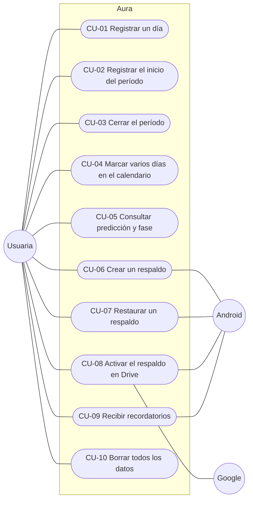
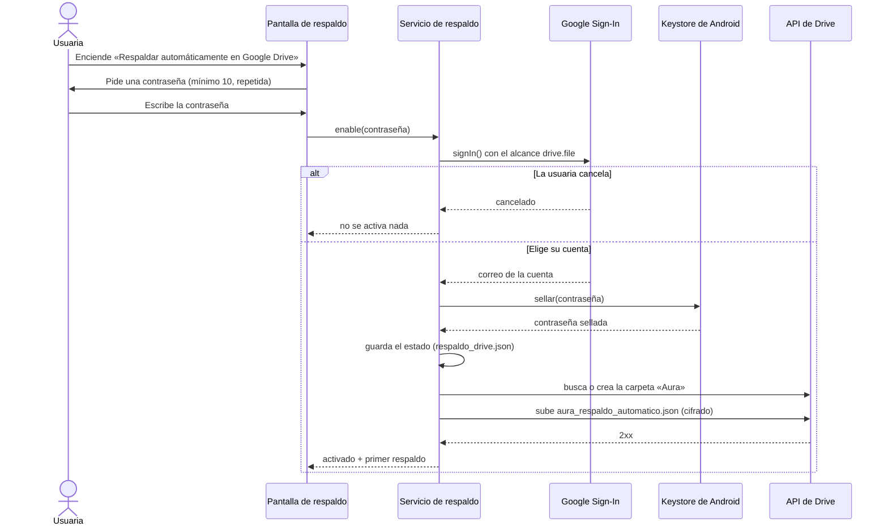
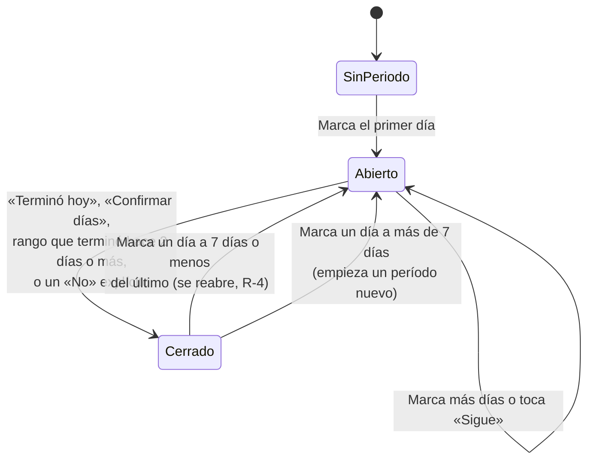
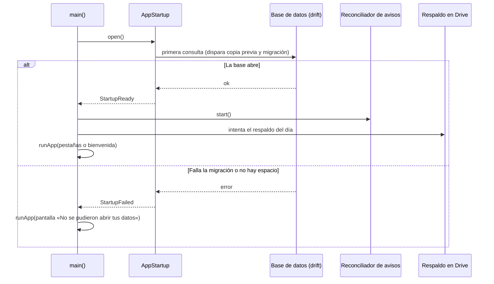

# 02 · Casos de uso

> **App:** Aura 1.2.0 (build 7) · **Revisión:** 2026-10-24
> **Fuentes:** criterios de aceptación de `ESPECIFICACION_v1.1.md`, `HU-09_respaldo_drive_v1.2.md` (Parte A) y el código en `lib/`.
> Los diagramas están en Mermaid y se ven directamente en GitHub.

## 1. Actores

| Actor | Descripción |
|---|---|
| **Usuaria** | Persona que usa Aura en su teléfono Android. Es la única que decide qué se registra, qué se respalda y dónde. |
| **Android** | El sistema operativo: notificaciones, Keystore (almacén de claves), selector de archivos y hoja de compartir. |
| **Google** | Inicio de sesión de Google y API de Drive. Solo interviene si la usuaria activa el respaldo automático. |

## 2. Diagrama de casos de uso

## 3. Especificación de los casos de uso

### CU-01 · Registrar un día

| Campo | Contenido |
|---|---|
| **Actor** | Usuaria |
| **Objetivo** | Guardar sangrado, flujo, ánimo, síntomas y notas de un día. |
| **Precondición** | Ninguna. Puede elegir cualquier fecha que no sea futura. |
| **Flujo principal** | 1. Abre «Registrar día». 2. Si el día ya tiene datos, se cargan; si no, todo parte «sin especificar» y el interruptor de sangrado apagado. 3. Elige lo que quiere registrar. 4. Toca «Guardar registro». 5. Aura guarda el día, recalcula ciclos y predicción, y reprograma los avisos. |
| **Flujos alternativos** | **A1.** Día vacío (nada elegido y sin registro previo): no se escribe nada y Aura avisa «No había nada para guardar». **A2.** Sale con cambios sin guardar: Aura pregunta «¿Descartar los cambios?». **A3.** Cambia de fecha con cambios pendientes: misma pregunta. **A4.** Apaga el sangrado en un día ya marcado: se guarda un «no» explícito. |
| **Postcondición** | El día queda guardado. Inicio, Calendario y Estadísticas lo reflejan sin reiniciar. |
| **Reglas** | El flujo solo cuenta con el sangrado encendido. Notas de hasta 2000 caracteres. No se guarda un ánimo ni un flujo que la usuaria no eligió (hallazgos B-2 y B-3). |
| **Trazabilidad** | RF-01 · B-1, B-2, B-3, T2-1 a T2-4 |

### CU-02 · Registrar el inicio del período («Me llegó hoy»)

| Campo | Contenido |
|---|---|
| **Actor** | Usuaria |
| **Objetivo** | Registrar que empezó el período con dos toques, sin marcar cada día. |
| **Precondición** | No hay un período en curso (en Inicio). En el Calendario siempre está disponible. |
| **Flujo principal** | 1. Toca «Me llegó hoy». 2. Elige Hoy, Ayer u Otro día. 3. Ve la duración estimada («puedes cambiarla en Ajustes» o «según tus últimos períodos»). 4. Toca «Marcar período». 5. Aura guarda **solo el primer día** y muestra los siguientes como estimados. 6. Aparece «Deshacer» durante 7 segundos. |
| **Flujos alternativos** | **A1.** La fecha cae tan cerca de otro período que se sumará a él: Aura lo avisa. **A2.** La fecha ya estaba marcada: lo informa y no duplica. |
| **Postcondición** | Un día de sangrado guardado; el período queda **abierto**. |
| **Reglas** | No se admite una fecha futura. Los estimados no se guardan (RNF-07). |
| **Trazabilidad** | RF-07, RF-09 · HU-02, E-1 |

### CU-03 · Cerrar el período

| Campo | Contenido |
|---|---|
| **Actor** | Usuaria |
| **Objetivo** | Indicar cuándo terminó el sangrado para que quede con su duración real. |
| **Precondición** | Hay un período abierto y está en la fase menstrual, o el último día marcado es de ayer o de hoy. |
| **Flujo principal** | 1. Inicio muestra «¿Sigue tu período hoy?». 2. Toca «Terminó hoy». 3. Aura marca como sangrado los días sin registro entre el inicio y hoy, respeta los «No» explícitos y cierra el período. 4. Aparece «Deshacer». |
| **Flujos alternativos** | **A1.** «Sigue»: marca hoy y vuelve a preguntar mañana. **A2.** «Ya terminó antes»: elige un día entre el inicio y hoy. **A3.** Si el período quedaría de 1 día, Aura pide confirmación. **A4.** Si hay días marcados después del elegido, se bloquea con un mensaje. **A5.** Desde el Calendario: «Confirmar días» (convierte los estimados en registrados) o «Terminó este día». |
| **Postcondición** | El período queda **cerrado** y entra al promedio de duración. |
| **Reglas** | Un período abierto no entra al promedio (P-1). Marcar un día a 7 días o menos de un período cerrado lo reabre (R-4). |
| **Trazabilidad** | RF-08, RF-09 · HU-03, D-1, P-1, R-4 |

### CU-04 · Marcar varios días en el calendario

| Campo | Contenido |
|---|---|
| **Actor** | Usuaria |
| **Objetivo** | Registrar un período pasado o corregir días sin marcar uno por uno. |
| **Precondición** | Está en el Calendario. |
| **Flujo principal** | 1. Toca «Elegir varios días». 2. El panel guía: «Toca el primer día», luego «Ahora toca el último día». 3. Con el rango listo ve un resumen corto («10 jul → 12 jul · 3 días»). 4. Toca «Marcar período». 5. Aura guarda exactamente esos días. |
| **Flujos alternativos** | **A1.** Con el rango completo, tocar un día **posterior** al final lo alarga; **anterior** al inicio mueve el inicio; **dentro** acorta el final. Nunca se descarta en silencio (U-1). **A2.** Más de 10 días: pide confirmación. **A3.** «Cancelar» vuelve a cero. **A4.** Un rango que termina hace 2 días o más cierra el período; si termina hoy o ayer, Aura pregunta «¿Ya terminó tu período?». |
| **Postcondición** | Días guardados y, según el caso, período cerrado. «Deshacer» restaura el estado previo en una sola transacción. |
| **Trazabilidad** | RF-09 · HU-04, U-1, R-1 |

### CU-05 · Consultar la predicción y la fase

| Campo | Contenido |
|---|---|
| **Actor** | Usuaria |
| **Objetivo** | Saber cuándo se espera el próximo período y qué tan fiable es la estimación. |
| **Precondición** | Hay al menos un período registrado. |
| **Flujo principal** | 1. Abre Inicio. 2. Ve la fase actual, el próximo período con su **rango** y la confianza (baja, media, alta). 3. Con confianza media o alta ve también la ovulación y la ventana fértil, con el aviso «Estimación; no es un método anticonceptivo». |
| **Flujos alternativos** | **A1.** Confianza baja: se muestra el rango con «(valor por defecto)» y una línea explica por qué no hay ventana fértil. **A2.** Período atrasado: «Período atrasado por N días», sin fase ni ventana. **A3.** Datos desactualizados (más de 60 días): invita a registrar un día, sin predicción. **A4.** El interruptor «Mostrar ovulación y ventana fértil» apagado las oculta. |
| **Postcondición** | Ninguna (consulta). |
| **Reglas** | `visibleFertileMarks` decide qué se ve. La predicción nunca se presenta como certeza. |
| **Trazabilidad** | RF-03, RF-04, RF-05 · HU-05a a HU-05d |

### CU-06 · Crear un respaldo

| Campo | Contenido |
|---|---|
| **Actor** | Usuaria · Android (selector de archivos, hoja de compartir) |
| **Objetivo** | Guardar una copia de sus datos fuera de la app. |
| **Precondición** | Ninguna. |
| **Flujo principal** | 1. En Ajustes → «Tus datos» toca «Crear respaldo». 2. Aura avisa que el archivo contiene datos de salud. 3. Aura ofrece protegerlo con una contraseña (mínimo 10 caracteres, con indicador de fortaleza). 4. La usuaria la escribe dos veces. 5. Aura cifra el archivo en el teléfono y comprueba que se puede abrir con esa contraseña. 6. Elige «Guardar en el teléfono» o compartirlo. |
| **Flujos alternativos** | **A1.** «Continuar sin contraseña»: advierte que el archivo quedará legible por cualquiera. **A2.** Cancela el «Guardar como» o cierra la hoja de compartir: no cuenta como respaldo. |
| **Postcondición** | Existe un archivo `aura_respaldo_protegido_<fecha>.json` (o sin cifrar). Se anota la fecha para el recordatorio. |
| **Reglas** | Aura no guarda esta contraseña ni puede recuperarla. |
| **Trazabilidad** | RF-12, RF-13, RF-14 · HU-06, HU-06b, HU-08 |

### CU-07 · Restaurar un respaldo

| Campo | Contenido |
|---|---|
| **Actor** | Usuaria · Android (selector de archivos) |
| **Objetivo** | Recuperar sus datos desde un archivo. |
| **Precondición** | Tiene un archivo de respaldo de Aura. |
| **Flujo principal** | 1. Toca «Restaurar un respaldo» y elige el archivo. 2. Aura lo **valida antes de tocar nada**. 3. Si está cifrado, pide la contraseña. 4. Muestra la fecha del respaldo y los recuentos («tiene N días con registro (M de período)»), y avisa si trae menos días que los actuales. 5. La usuaria confirma. 6. Aura guarda antes una copia de los datos actuales y los reemplaza en una sola transacción. 7. Aparece «Deshacer». |
| **Flujos alternativos** | **A1.** Archivo inválido o dañado: lo dice y no cambia nada. **A2.** Versión más nueva: pide actualizar la app. **A3.** Contraseña incorrecta o archivo alterado: lo dice, permite reintentar sin volver a elegir el archivo. **A4.** Memoria insuficiente al derivar la clave: mensaje claro y reintento. |
| **Postcondición** | Los datos quedan reemplazados; las notificaciones se reprograman; «Deshacer» devuelve el estado anterior mientras exista la copia. |
| **Trazabilidad** | RF-12, RF-13 · HU-06, HU-06b |

### CU-08 · Activar el respaldo automático en Google Drive

| Campo | Contenido |
|---|---|
| **Actor** | Usuaria · Google · Android (Keystore) |
| **Objetivo** | Que sus datos se respalden solos y cifrados en su propio Drive. |
| **Precondición** | La compilación trae el client ID de Google. Si no, la opción muestra «Configuración pendiente». |
| **Flujo principal** | Ver el diagrama de secuencia de la sección 4. |
| **Flujos alternativos** | **A1.** Cancela la elección de cuenta: no queda nada activado. **A2.** Falla la conexión con Google: «No se pudo conectar con Google; no se activó el respaldo». **A3.** El Keystore no puede guardar la clave: aviso y reintento. |
| **Postcondición** | Respaldo automático activado, con la cuenta visible y un primer respaldo subido. A partir de ahí, a lo sumo uno por día (al abrir, reanudar o guardar un registro). |
| **Reglas** | Siempre cifrado. Alcance `drive.file`. Un solo archivo que se reemplaza. |
| **Trazabilidad** | RF-15 · HU-09 (Parte A) |

### CU-09 · Recibir recordatorios

| Campo | Contenido |
|---|---|
| **Actor** | Usuaria · Android (notificaciones) |
| **Objetivo** | Recibir avisos discretos del período, la ventana fértil o el atraso. |
| **Precondición** | Activó el interruptor general de notificaciones y concedió el permiso de Android. |
| **Flujo principal** | 1. Activa los avisos que quiere en Ajustes → Notificaciones. 2. Aura planifica qué debe estar programado y lo reconcilia. 3. A la hora elegida llega un aviso con texto genérico («Abre la app para ver el detalle»). |
| **Flujos alternativos** | **A1.** Si no concede el permiso, Aura ofrece «Abrir ajustes». **A2.** Con confianza baja, período atrasado o el interruptor de ovulación apagado, el aviso de ventana fértil no se programa. **A3.** Tras reiniciar el teléfono o actualizar la app, los avisos se reprograman. |
| **Postcondición** | Avisos programados según el estado actual de los datos. |
| **Trazabilidad** | RF-11 · HU-05a, RR-6 |

### CU-10 · Borrar todos los datos

| Campo | Contenido |
|---|---|
| **Actor** | Usuaria |
| **Objetivo** | Eliminar todo lo que Aura guarda en el teléfono. |
| **Flujo principal** | Desde Ajustes, la usuaria elige «Borrar todos los datos». Aura elimina registros y síntomas, vuelve los ajustes a sus valores por defecto, borra las copias internas (`respaldos/`), olvida la cuenta de Drive y compacta la base (`VACUUM`) para que no queden restos. |
| **Postcondición** | La app queda como recién instalada. Los archivos que ya estaban en Drive **no se borran** desde la app. |
| **Trazabilidad** | RF-16 · v1.0, 1.1.1 |

## 4. Diagramas complementarios

### Activación del respaldo en Drive (CU-08)

### Ciclo de vida de un período (CU-02, CU-03, CU-04)

### Arranque de la app

