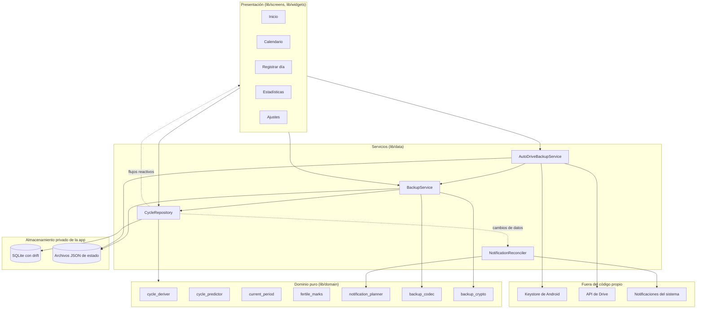

# 03 · Arquitectura

> **App:** Aura 1.2.0 (build 7) · **Revisión:** 2026-10-24
> **Fuentes:** `lib/` (en particular `main.dart`, `app_startup.dart`, `data/` y `domain/`), `pubspec.yaml`, `README.md` y la especificación.

## 1. Visión general

Aura es una app **Flutter solo para Android**, con una arquitectura por capas pensada para que la lógica del ciclo se pueda probar sin teléfono, sin base de datos y sin reloj real.



## 2. Capas y responsabilidades

| Capa | Ubicación | Responsabilidad | No debe |
|---|---|---|---|
| **Presentación** | `lib/screens/`, `lib/widgets/` | Pantallas, diálogos y hojas. Reaccionan a flujos de datos. | Contener reglas del ciclo |
| **Servicios y datos** | `lib/data/` | Repositorio (`CycleRepository`), base drift, respaldo, notificaciones, almacenes de estado en JSON. | Depender de widgets |
| **Dominio puro** | `lib/domain/` | Derivar ciclos, predecir, decidir qué se muestra, planificar avisos, codificar y cifrar respaldos. Son **funciones puras**. | Importar Flutter ni la base de datos |
| **Utilidades** | `lib/utils/` | `DayKey` (fechas), colores, textos, zona horaria, Keystore, canales de Android. | — |

### Módulos del dominio

| Módulo | Qué hace |
|---|---|
| `cycle_deriver.dart` | De los días de sangrado obtiene períodos y ciclos (`CycleSummary`). |
| `cycle_predictor.dart` | `predictCycle`: próximo período con rango y confianza; fases; ovulación y ventana. `PredictionConfig` concentra todos los umbrales. |
| `current_period.dart` | Estado del período en curso: estimados, abierto o cerrado, qué ofrecer a la usuaria. |
| `fertile_marks.dart` | `visibleFertileMarks`: la **regla única** de cuándo se muestran ovulación y ventana. |
| `notification_planner.dart` | `planNotifications`: calcula qué avisos deben estar programados. |
| `range_selection.dart` | Máquina de estados de la selección de rango del calendario. |
| `backup_codec.dart` | Codifica y valida el documento de respaldo antes de tocar la base. |
| `backup_crypto.dart` | Argon2id + AES-256-GCM; formato cifrado `formatVersion` 2. |
| `backup_reminder.dart`, `password_strength.dart`, `symptom_ranking.dart`, `legacy_period_ends.dart` | Reglas del recordatorio, fortaleza de contraseña, orden de síntomas y migración de períodos antiguos. |

## 3. Flujo de datos

1. La usuaria registra un día. `CycleRepository` lo escribe en SQLite.
2. drift emite **flujos reactivos** (`watchDerivedCycles`, `watchPredictionInputs`, `watchStats`…). Las pantallas se redibujan solas.
3. `NotificationReconciler` escucha los cambios, pide a `planNotifications` el plan y lo aplica al programador del sistema.
4. Si el respaldo automático está activo, guardar un registro dispara un intento de respaldo (a lo sumo uno por día).

**Fuente única de verdad:** solo se guardan los **días de sangrado**. Los ciclos, la duración, la predicción y las fases se **derivan**. Así, editar un día recalcula todo de forma consistente.

## 4. Arranque

`main()` sigue un orden deliberado (ver el diagrama de arranque en [`02_casos_de_uso.md`](02_casos_de_uso.md)):

1. Inicializa el formato de fechas en español y el programador de notificaciones. Si este último falla, la app abre igual, sin avisos.
2. Aplica la protección de pantalla elegida («Ocultar Aura en Recientes»).
3. `AppStartup.open()` **abre la base primero**. Esa primera consulta dispara la copia previa y la migración. Si falla, se muestra `UpdateErrorScreen` con «Reintentar» y **no se programa ningún aviso ni se limpia ningún temporal**.
4. Con la base abierta: arranca el reconciliador, se limpian temporales, se borra la copia previa a la migración si tiene más de 30 días y se intenta el respaldo automático del día.

**Por qué:** antes, un fallo al abrir la base ocurría antes de `runApp` y dejaba la app congelada en la pantalla de inicio (decisión M-4).

## 5. Concurrencia y robustez

| Mecanismo | Dónde | Qué evita |
|---|---|---|
| `Isolate` para derivar la clave y cifrar | `BackupService` (`runInIsolate`) | Congelar la interfaz con Argon2id |
| Cola de respaldos (una operación a la vez) | `AutoDriveBackupService.maybeBackup` | Subidas solapadas |
| Cola de corridas en el reconciliador | `NotificationReconciler` | Planes a medias que cancelen avisos |
| `BackupBusyScope` | `MainNavigationScreen` | Dos operaciones de respaldo a la vez entre Ajustes e Inicio |
| Escrituras atómicas (archivo temporal + renombrar) | Almacenes JSON | Archivos de estado corruptos |
| Migración dentro de una transacción con verificaciones | `AppDatabase.onUpgrade` | Una base a medio migrar |
| Copia previa antes de migrar o importar | `pre_migration_copy`, `BackupService` | Perder datos si algo falla |
| Mensajes de error sin texto técnico | Pantallas | Filtrar datos de salud en un mensaje |

## 6. Plataforma Android

- **Canal nativo** `com.soofiaa.aura/system`: protección de pantalla, abrir los ajustes de notificaciones y operaciones del Keystore (`keystoreEncrypt`, `keystoreDecrypt`). Se implementa en `MainActivity.kt`, el único archivo Kotlin propio. *Nota de verificación: el lado Dart del canal se revisó; el archivo Kotlin no se pudo leer al preparar este documento, así que la lista exacta de métodos nativos queda por confirmar.*
- **Manifest:** orientación vertical, `allowBackup="false"` y `dataExtractionRules` que excluyen todo. Detalle en [`05_permisos_y_privacidad.md`](05_permisos_y_privacidad.md).
- **Navegación:** `MainNavigationScreen` con cuatro destinos fijos (Inicio, Calendario, Estadísticas, Ajustes) y `IndexedStack`, para conservar el estado de cada pestaña.

## 7. Dependencias principales

| Paquete | Para qué |
|---|---|
| `drift`, `sqlite3`, `sqlite3_flutter_libs` | Base de datos local con consultas tipadas y migraciones |
| `table_calendar` | Calendario |
| `fl_chart` | Gráficos de Estadísticas |
| `flutter_local_notifications`, `timezone`, `flutter_timezone` | Avisos locales programados |
| `cryptography` (versión exacta 2.9.0) | Argon2id y AES-256-GCM en Dart puro |
| `share_plus`, `file_picker` | Compartir y elegir archivos de respaldo |
| `google_sign_in`, `http` | Respaldo en Drive (cliente REST propio, sin SDK de Google) |
| `url_launcher` | Abrir la política de privacidad en el navegador |
| `intl`, `flutter_localizations` | Textos y fechas en español |

Para desarrollo: `drift_dev` y `build_runner` (código generado), `flutter_launcher_icons`, `flutter_native_splash`, `flutter_lints`.

## 8. Patrones y compromisos

**Lo que funciona bien**

- Dominio puro: la mayor parte de las reglas se prueba con fechas fijas, sin dobles pesados.
- Reloj y base **inyectables** (`AppDatabase.forTesting`, parámetros `now`/`today`), lo que permite probar migraciones y cambios de día.
- Interfaces con dobles de prueba (`NotificationScheduler`, `DriveBackupGateway`, `KeystoreVault`, `BackupFileGateway`).

**Compromisos a tener presentes**

- Algunos servicios se exponen como **instancias globales** (`cycleRepository`, `autoDriveBackupService`, `keystoreVault`) con *setters* solo para tests. Es simple, pero acopla más que la inyección por constructor.
- `CycleRepository` es grande (916 líneas) y concentra lecturas, escrituras, ajustes y respaldo. Un candidato natural a dividirse.
- La base de datos **no está cifrada** dentro del teléfono; la contraseña protege solo el archivo de respaldo.

## 9. Compilación

```bash
flutter pub get
dart run build_runner build --delete-conflicting-outputs
flutter run                 # con el respaldo en Drive: --dart-define-from-file=secrets.json
flutter test
```

Requisitos: Flutter estable y JDK 17–21. La configuración del respaldo en Drive está en [`DRIVE_SETUP.md`](DRIVE_SETUP.md); el release firmado, en `android/RELEASE.md`. La clave de firma y `secrets.json` no están en el repositorio.
