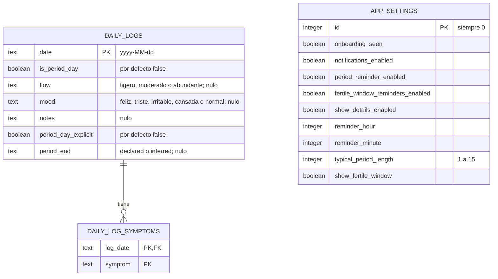

# 04 · Modelo de datos

> **App:** Aura 1.2.0 (build 7) · **Esquema de la base:** v5 · **Revisión:** 2026-10-24
> **Fuentes:** `lib/data/database/app_database.dart`, `lib/data/models/day_enums.dart`, `lib/domain/backup_codec.dart`, los almacenes JSON de `lib/data/` y las decisiones D-1, D-2, M-1 a M-4 de la especificación.

## 1. Idea central

**Solo se guardan los días de sangrado y lo que la usuaria registra de cada día.** Los períodos, los ciclos, las duraciones, la predicción y las fases **no se almacenan**: se derivan. Hay una única fuente de verdad, y corregir un día recalcula todo de forma consistente.

## 2. Diagrama entidad-relación



`APP_SETTINGS` tiene una sola fila (`id = 0`) y no se relaciona con las otras tablas.

## 3. Tablas

### `daily_logs`: un registro por día

| Columna | Tipo | Regla |
|---|---|---|
| `date` | texto `yyyy-MM-dd` | **Clave primaria.** A lo sumo un registro por día. |
| `is_period_day` | booleano | Si el día es de sangrado. |
| `flow` | texto, nulo | Valores: `ligero`, `moderado`, `abundante`. |
| `mood` | texto, nulo | Valores: `feliz`, `triste`, `irritable`, `cansada`, `normal`. |
| `notes` | texto, nulo | Hasta 2000 caracteres (límite de la interfaz). |
| `period_day_explicit` | booleano | `true` si la usuaria dijo **explícitamente** que no hubo sangrado. Distingue «dijo que no» de «no dijo nada». |
| `period_end` | texto, nulo | `declared` (la usuaria dijo que terminó) o `inferred` (lo escribió la migración). Solo en el **último** día de sangrado de un período. |

**Restricciones (`CHECK`) que codifican reglas de negocio:**

- `flow IS NULL OR is_period_day = 1`: no puede haber flujo en un día sin sangrado.
- `period_end IS NULL OR is_period_day = 1`: no se puede cerrar un período en un día sin sangrado.

### `daily_log_symptoms`: síntomas de cada día

| Columna | Tipo | Regla |
|---|---|---|
| `log_date` | texto | Clave primaria compuesta con `symptom`. Clave foránea a `daily_logs.date`, con `ON DELETE CASCADE`. |
| `symptom` | texto | `dolorAbdominal`, `dolorDeCabeza`, `cansancio`, `antojos`, `cambiosDeHumor`, `hinchazon`, `acne`, `dolorDeEspalda`. |

### `app_settings`: ajustes de la app

| Columna | Por defecto | Para qué |
|---|---|---|
| `onboarding_seen` | `false` | Si ya vio la presentación inicial |
| `notifications_enabled` | `false` | Interruptor general de avisos (opt-in) |
| `period_reminder_enabled` | `true` | Aviso del período |
| `fertile_window_reminders_enabled` | `false` | Aviso de la ventana fértil |
| `show_details_enabled` | `false` | Texto con detalle en los avisos |
| `reminder_hour`, `reminder_minute` | 9 y 0 | Hora de los avisos |
| `typical_period_length` | 5 | Duración habitual (1 a 15, con `CHECK`) |
| `show_fertile_window` | `true` | Mostrar ovulación y ventana fértil |

La fila única se fuerza con `CHECK (id = 0)`.

## 4. Decisiones de modelado

| Decisión | Motivo |
|---|---|
| **La fecha es texto `yyyy-MM-dd` y clave primaria.** | Un día del calendario no es un instante. Guardarlo como texto evita corrimientos por zona horaria. En Chile el cambio de hora ocurre a medianoche, así que a veces la medianoche local no existe; operar en UTC sobre ese texto elimina esa clase de errores. |
| **Los ciclos se derivan, no se almacenan.** | Una sola fuente de verdad. Un nuevo período empieza cuando el día de sangrado anterior está a más de 7 días. |
| **`period_day_explicit` (esquema v3).** | Permite distinguir «sin sangrado declarado» de «no se dijo nada». Es una excepción deliberada a las escrituras no destructivas, necesaria para que «quitar marca» y el fin del período sean fiables. |
| **`period_end` en la fila del último día (D-1).** | Todo el estado queda en las filas de `daily_logs`: «Deshacer» funciona con una foto de las filas afectadas, el respaldo exporta una columna más y el derivador sigue siendo puro. Se descartaron una tabla de cierres (dos fuentes de verdad) y reutilizar `period_day_explicit` (obligaba a guardar días futuros falsos). |
| **Los `CHECK` están en la base, no solo en el código.** | Ninguna escritura directa puede violar las reglas. El `CHECK` de `period_end` va en la columna para que una instalación nueva y una migrada tengan el mismo esquema. |
| **Los días estimados nunca se guardan.** | El predictor no debe aprender de su propia suposición. |

## 5. Historial de migraciones

| De → a | Cambio | Cómo se protege |
|---|---|---|
| v1 → v3 | Escritas a mano; incluyen `period_day_explicit` | Tests de migración |
| **v3 → v4** | Agrega `daily_logs.period_end` y `app_settings.typical_period_length`. Cierra con `inferred` los períodos antiguos que cumplen la regla D-2 (conservadora). | Transacción explícita con verificaciones antes de confirmar: no cambió la cantidad de días ni de síntomas, `foreign_key_check` limpio, ningún `period_end` en un día sin sangrado. **Copia previa** del archivo (`VACUUM INTO`) antes de abrir una base v1 a v3. |
| **v4 → v5** | Agrega `app_settings.show_fertile_window` | Transacción; comprueba que no cambie la cantidad de filas de ninguna tabla. |

**Compatibilidad hacia atrás:** no se admite abrir una base nueva con una app más antigua. Una app v4 no puede abrir una base v5: los datos quedan intactos, pero la app muestra «No se pudieron abrir tus datos» hasta volver a una versión compatible.

**Herramientas:** `drift_dev make-migrations` guarda volcados de cada esquema en `drift_schemas/aura/` y genera el andamiaje de los pasos y los esquemas de prueba (`test/drift/aura/generated/`). El contenido de cada paso está escrito a mano.

## 6. Estado fuera de la base

Estos archivos viven en el almacenamiento privado de la app y **no** forman parte de la base ni del respaldo exportable. «Borrar todos los datos» está pensado para limpiar también estos archivos; *queda por confirmar en el código cuáles elimina exactamente* (en particular `respaldo_drive.json`).

| Archivo | Contenido | Por qué fuera de la base |
|---|---|---|
| `ajustes_telefono.json` | `ocultarEnRecientes`, `avisoAtraso` | Son ajustes de **este teléfono**: importar un respaldo no debe pisarlos. Sin migración. |
| `recordatorio_respaldo.json` | `primerUso`, `ultimoRespaldo`, `pospuestoHasta`, `activado` | Estado del recordatorio de respaldo. |
| `respaldo_drive.json` | Si está habilitado, cuenta, contraseña **sellada** por el Keystore, último respaldo y último fallo | Estado del respaldo en Drive; nunca debe viajar en un respaldo. |
| `respaldos/antes_de_importar.json` | Copia **sin cifrar** de los datos previos a una importación | Solo para «Deshacer». |
| `respaldos/antes_de_migrar_v4.sqlite` | Copia de la base previa a migrar (solo bases v1 a v3) | Red de seguridad de la migración; se borra a los 30 días o tras guardar un respaldo en el teléfono. |

Todas las escrituras son atómicas (archivo temporal y renombrado).

## 7. Formato del archivo de respaldo

El respaldo es un **JSON propio y versionado**, no una copia de la base: se puede validar completo antes de tocar nada, no depende del formato interno de drift y un esquema anterior se puede importar convirtiéndolo.

| Campo / versión | Significado |
|---|---|
| `format` | Siempre `aura-backup` |
| `formatVersion` | **1**: documento sin cifrar. **2**: documento cifrado (envoltorio). |
| `schemaVersion` | Versión del esquema de datos. La actual es **5**. Una app rechaza respaldos de un esquema posterior. |
| `appVersion`, `exportedAt` | Versión de la app y fecha de exportación |
| Datos | Días, síntomas y ajustes (sin el interruptor general de avisos, que depende del permiso de cada teléfono) |

**Compatibilidad:** los respaldos v3 y v4 se importan con la regla D-2 y el interruptor de ventana fértil activado. La importación valida fechas con un tope razonable y el tamaño máximo (5 MiB sin cifrar; el cifrado en base64 se agranda y el tope lo considera).

**Respaldo cifrado (`formatVersion` 2):**

```json
{
  "format": "aura-backup",
  "formatVersion": 2,
  "app": "Aura",
  "encryption": {
    "cipher": "AES-256-GCM",
    "kdf": "Argon2id",
    "kdfParams": { "memoryKiB": 19456, "iterations": 2, "parallelism": 1 },
    "salt": "<16 bytes en base64>",
    "nonce": "<12 bytes en base64>"
  },
  "ciphertext": "<texto cifrado + etiqueta de 16 bytes, en base64>"
}
```

El encabezado entra como dato adicional autenticado: alterar cualquier campo hace fallar el descifrado. Antes de derivar la clave, Aura valida que los algoritmos sean los conocidos y que los parámetros estén dentro de límites (memoria de 8 192 a 65 536 KiB, 1 a 10 iteraciones, paralelismo 1), para que un archivo manipulado no pida recursos enormes.

## 8. Datos derivados (no se guardan)

| Dato | Se obtiene de | Función |
|---|---|---|
| Períodos y ciclos (`CycleSummary`) | Días de sangrado, «No» explícitos y `period_end` | `deriveCycles` |
| Duración típica del ciclo y regularidad | Ciclos válidos de los últimos 6 | `estimateCycleLength`, `cycleRegularity` |
| Duración del período | Períodos cerrados, o la duración habitual | `estimatePeriodLength` |
| Predicción, fase, ovulación y ventana | Lo anterior y la fecha de hoy | `predictCycle` |
| Días estimados del período en curso | Período actual, duración habitual y hoy | `current_period.dart` |
| Avisos que deben estar programados | Predicción y ajustes | `planNotifications` |
